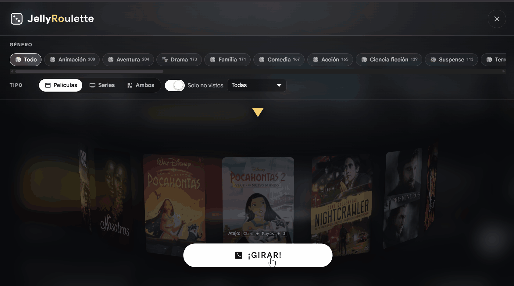

# 🎲 JellyRoulette


**Español** · [English](README.md)


> Plugin para **Jellyfin** que añade un dado en la cabecera de la web. Lo pulsas, eliges género y tipo de medio, y una ruleta 3D de pósters gira hasta detenerse en un título elegido **al azar** entre todos los que cumplen tus filtros.
>
> Para cuando la pregunta no es _«qué veo»_, sino _«no sé qué ver»_.

<p align="center"></p>

## Índice

- [Visión general](#visión-general)
- [Características](#características)
- [Nota de idioma](#nota-de-idioma)
- [Requisitos](#requisitos)
- [Instalación](#instalación)
  - [Instalación desde el catálogo (recomendada)](#instalación-desde-el-catálogo-recomendada)
  - [Instalación manual](#instalación-manual)
- [Actualización](#actualización)
- [Uso](#uso)
  - [Teclado y móvil](#teclado-y-móvil)
  - [Filtros](#filtros)
  - [Ajustes del plugin](#ajustes-del-plugin)
- [Solución de problemas](#solución-de-problemas)
- [Desinstalar](#desinstalar)
- [Desarrollo](#desarrollo)
  - [Compilar desde el código fuente](#compilar-desde-el-código-fuente)
  - [Pruebas](#pruebas)
- [API](#api)
- [Soporte](#soporte)
- [Reconocimientos](#reconocimientos)

## Visión general

JellyRoulette te ayuda a descubrir algo que ver desde tu propia biblioteca de Jellyfin. En lugar de estar haciendo scroll sin parar, defines algunos filtros y dejas que el plugin elija un título al azar entre los elementos que cumplen esos filtros.

## Características

- Selector aleatorio de títulos basado en los filtros de tu biblioteca.
- Animación de ruleta 3D con pósters.
- Detección automática de idioma: La interfaz se adapta al español o inglés según la configuración del navegador del usuario.
- Filtros por género, tipo de medio, estado de visionado y biblioteca.
- Botón con dado en la cabecera y atajo de teclado: `Ctrl` / `⌘` + `Shift` + `J`.
- Botón flotante de respaldo en móvil.
- Duración del giro, número de pósters, filtros por defecto y límite de géneros configurables.
- API REST para la lógica de la ruleta y los metadatos de la biblioteca.
- Compilaciones separadas para Jellyfin 12.x y 10.11.x.

## Soporte de idiomas

La interfaz del plugin **detecta automáticamente** el idioma del navegador del usuario y muestra la interfaz en **español** o **inglés**. 

La documentación también está disponible en ambos idiomas mediante el selector en la parte superior de este archivo.

## Requisitos

| Requisito | Detalle |
| --- | --- |
| **Jellyfin** | **12.x** (recomendado) o **10.11.x** |
| **Navegador** | Cualquier navegador moderno en PC o móvil |
| **Biblioteca** | Alguna biblioteca escaneada con películas y/o series |

Puedes consultar tu versión en **Panel de control → General**, o ejecutar:

```bash
curl -s http://localhost:8096/System/Info/Public | grep Version
```

Sustituye `localhost:8096` por la dirección de tu servidor Jellyfin si es necesario.

## Instalación

### Instalación desde el catálogo (recomendada)

De esta forma, el plugin podrá actualizarse desde el panel de administración.

1. Entra en Jellyfin como **administrador**.
2. Ve a **Panel de control → Plugins → Repositorios** y pulsa **`+`**.
3. Rellena:
   - **Nombre:** `JellyRoulette`
   - **URL:** usa la URL correspondiente a tu versión de Jellyfin.

**Jellyfin 12.x**

```text
https://raw.githubusercontent.com/ysflamine/JellyRoulette/main/manifest.json
```

**Jellyfin 10.11.x**

```text
https://raw.githubusercontent.com/ysflamine/JellyRoulette/main/manifest-10.11.json
```

4. Guarda, abre la pestaña **Catálogo**, busca **JellyRoulette** en la categoría **General** y pulsa **Instalar**.
5. **Reinicia el servidor.**
6. Recarga la web con **`Ctrl + Shift + R`** (recarga dura).

> [!NOTE]
> ¿Por qué dos URLs? Cada rama de Jellyfin necesita una compilación distinta: .NET 10 para la 12.x y .NET 9 para la 10.11.x. No son intercambiables.

### Instalación manual

1. Descarga desde **Releases** el `.zip` correspondiente a tu rama:
   - Jellyfin **12.x** → `jellyroulette_12.zip`
   - Jellyfin **10.11.x** → `jellyroulette_10.11.zip`
2. Extrae estos dos archivos en una **subcarpeta llamada `JellyRoulette`** dentro de la carpeta de plugins de Jellyfin:
   - `Jellyfin.Plugin.JellyRoulette.dll`
   - `meta.json`

| Tipo de instalación | Ruta de plugins |
| --- | --- |
| Windows (instalador o servicio) | `C:\ProgramData\Jellyfin\Server\plugins\JellyRoulette\` |
| Linux (paquete) | `/var/lib/jellyfin/plugins/JellyRoulette/` |
| Docker | `/config/plugins/JellyRoulette/` |
| macOS | `~/.local/share/jellyfin/plugins/JellyRoulette/` |

3. Reinicia el servidor y recarga la web con **`Ctrl + Shift + R`**.

> [!WARNING]
> La DLL debe estar dentro de su propia subcarpeta `JellyRoulette`, no suelta directamente en `plugins/`.

> [!WARNING]
> En Linux y Docker, revisa los permisos de lectura. Si el proceso de Jellyfin no puede leer la DLL, puede ignorar el plugin en silencio.

## Actualización

- **Instalación desde catálogo:** actualiza desde **Panel de control → Plugins → Catálogo**, reinicia el servidor y haz una recarga dura de la web.
- **Instalación manual:** descarga el `.zip` correcto para tu rama de Jellyfin, sustituye `Jellyfin.Plugin.JellyRoulette.dll` y `meta.json` dentro de `plugins/JellyRoulette/`, reinicia el servidor y haz una recarga dura de la web.

## Uso

### Teclado y móvil

1. Pulsa el **dado 🎲** de la cabecera, o usa el atajo `Ctrl` / `⌘` + `Shift` + `J`.
2. Ajusta los filtros.
3. Pulsa GIRAR / SPIN (la etiqueta se adapta al idioma de tu navegador).
4. La ruleta gira y se detiene en el título seleccionado.
5. En la ficha del resultado puedes Reproducir / Play, Ver ficha / View details o Girar otra vez / Spin again.
6. Pulsa `Esc` para cerrar.

En móvil aparece además un **botón flotante** en la esquina inferior derecha.

### Filtros

| Filtro | Opciones |
| --- | --- |
| **Género** | Chips de selección múltiple con el número de títulos de cada género. Varios géneros se combinan con **O**. |
| **Tipo** | Películas · Series · Ambos |
| **Estado** | Solo no vistos · Todos |
| **Biblioteca** | Todas las bibliotecas, o una concreta |

### Ajustes del plugin

Ve a **Panel de control → Plugins → JellyRoulette → Ajustes**.

| Ajuste | Para qué sirve |
| --- | --- |
| Mostrar JellyRoulette en la interfaz web | Desactiva el botón inyectado en la cabecera. La API sigue funcionando. |
| Botón flotante | `Automático` (móvil o si la cabecera falla) · `Siempre` · `Nunca` |
| Tipo de medio por defecto | Con qué filtro abre la ruleta |
| Filtrar «solo no vistos» por defecto | Igual, pero para el estado de visionado |
| Duración del giro (ms) | `1600`–`9000`. Valores más altos dan más dramatismo |
| Pósters en la ruleta | Número de pósters candidatos descargados por tirada (`8`–`60`) |
| Máximo de géneros | Muestra primero los géneros con más títulos |

Los cambios se aplican al recargar la interfaz web. No hace falta reiniciar el servidor.

## Solución de problemas

| Síntoma | Solución |
| --- | --- |
| El plugin no aparece en **Panel de control → Plugins** | La DLL debe estar en `plugins/JellyRoulette/`, no directamente en `plugins/`. Revisa los permisos de lectura. |
| El plugin aparece, pero no sale el dado en la cabecera | Haz una recarga dura con `Ctrl + Shift + R`. Si sigue sin aparecer, activa **Botón flotante → Siempre** en los ajustes. |
| El estado del plugin es **Malfunctioned** | Estás usando la DLL compilada para la otra rama de Jellyfin. Descarga el `.zip` correcto. |
| La ruleta sale vacía (por ejemplo, «Nada por aquí…») | Ningún título cumple esos filtros. Quita algún género o desactiva **Solo no vistos**. |
| La ruleta sale vacía y no se muestran géneros | La biblioteca no está escaneada o no tiene metadatos. Ve a **Panel de control → Bibliotecas → Escanear todas**. |
| Los pósters se ven como cuadros grises | El título no tiene imagen **Primary**. Añade un póster en Jellyfin. |
| Falla la instalación desde el catálogo | Revisa el log del servidor y busca `JellyRoulette`, `checksum` o `Only zip`. |
| Después de actualizar sigue cargándose la versión antigua | Haz una recarga dura con `Ctrl + Shift + R`. El navegador puede tener cacheado `index.html`. |

**¿Dónde está el log?**

| Sistema | Ubicación del log |
| --- | --- |
| Windows | `C:\ProgramData\Jellyfin\Server\log\log_YYYYMMDD.log` |
| Linux | `/var/log/jellyfin/log_YYYYMMDD.log` |
| Docker | `docker logs jellyfin --tail 100` |

## Desinstalar

Usa **Panel de control → Plugins → JellyRoulette → Desinstalar** y reinicia el servidor.

Eliminación manual:

1. Borra la carpeta `plugins/JellyRoulette/`.
2. Reinicia Jellyfin.
3. Opcional: borra también el archivo de ajustes en `configurations/JellyRoulette_<guid>.xml` si quieres empezar completamente de cero. La parte del GUID puede variar.

## Desarrollo

### Compilar desde el código fuente

| Versión de Jellyfin | SDK de .NET | Comando |
| --- | --- | --- |
| 12.x | 10.0.x | `dotnet publish Jellyfin.Plugin.JellyRoulette -c Release -o publish` |
| 10.11.x | 9.0.x | `dotnet publish Jellyfin.Plugin.JellyRoulette -c Release -o publish-jf10 -p:JellyfinTarget=jf10` |

Copia `Jellyfin.Plugin.JellyRoulette.dll` y `meta.json` a la carpeta de plugins y reinicia Jellyfin. Los archivos `.pdb`, `.xml` y `.deps.json` no hacen falta.

### Pruebas

```bash
dotnet test tests/JellyRoulette.Tests        # pruebas de backend
cd tests/frontend && npm install && npm test # pruebas de front-end (jsdom)
```

El backend tiene actualmente 41 tests, aunque el número exacto puede cambiar con el tiempo.

## API

Todas las rutas de datos requieren una sesión autenticada de Jellyfin. Envía la cabecera:

```http
Authorization: MediaBrowser Token="YOUR_TOKEN"
```

| Método | Ruta | Descripción |
| --- | --- | --- |
| `GET` | `/JellyRoulette/Spin` | Elige un título al azar y devuelve pósters para la animación |
| `GET` | `/JellyRoulette/Genres` | Devuelve los géneros de la biblioteca con recuento de títulos |
| `GET` | `/JellyRoulette/Libraries` | Devuelve las bibliotecas del servidor |
| `GET` | `/JellyRoulette/Info` | Devuelve la versión del plugin y los ajustes activos |

### Parámetros de consulta de `/Spin`

| Parámetro | Tipo | Notas |
| --- | --- | --- |
| `mediaType` | `movie`, `series` o `both` | Filtro por tipo de medio |
| `unwatchedOnly` | booleano | Usa `true` para limitar a elementos no vistos |
| `libraryId` | GUID | ID de biblioteca opcional |
| `genres` | cadenas separadas por coma | Usa nombres internos de género, por ejemplo `Horror,Comedy` |
| `candidates` | entero | Número de pósters candidatos, normalmente `1`–`60`; el ajuste de interfaz usa `8`–`60` |

Ejemplo:

```http
GET /JellyRoulette/Spin?mediaType=movie&unwatchedOnly=true&genres=Horror,Comedy&candidates=24
```

## Soporte

Si algo no funciona, abre una incidencia con:

- Versión de Jellyfin.
- Versión de JellyRoulette.
- Método de instalación: catálogo o manual.
- Sistema operativo y tipo de despliegue: Windows, Linux, Docker, macOS.
- Navegador y si estás en escritorio o móvil.
- Líneas relevantes del log del servidor.
- Pasos para reproducir el problema.
- Comportamiento esperado y comportamiento real.

Las pull requests son bienvenidas.

## Reconocimientos

Hecho para [Jellyfin](https://jellyfin.org/). Gracias al proyecto y a la comunidad de Jellyfin.
